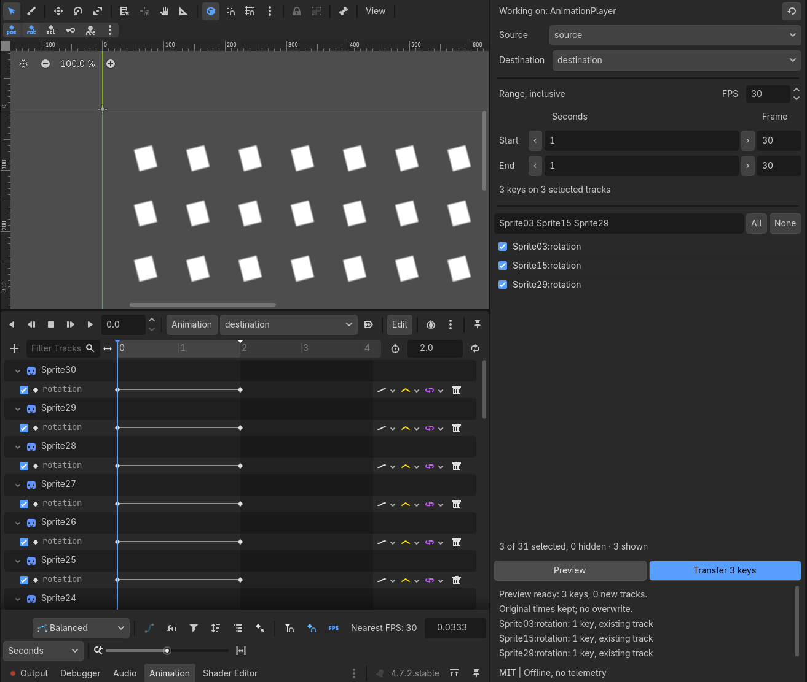

# Animation Segment Transfer

Merge selected scalar property keys from one animation clip into another without copying whole tracks. Keys keep their original times; existing destination keys are not overwritten. Matching uses the full property path and track type, not row order.

Merge three selected keys into existing tracks, without copying whole tracks.

## Quick start

Use `animation-segment-transfer-v0.1.0-addon.zip` to install the add-on in an existing project. To try the ready-made example, use `animation-segment-transfer-v0.1.0-demo.zip`; only that download includes `project.godot` and `demo/demo.tscn`.

1. **Install the add-on or open the demo download.** Choose the download for your route and use Godot 4.7.2.

   For an existing project, copy the folder under your project's `addons/` directory, then enable **Animation Segment Transfer** in **Project > Project Settings > Plugins**. Both clips must belong to the same AnimationPlayer in a local scene.

   The demo download has the plugin enabled in `project.godot`. Extract that download, open its `project.godot` in Godot 4.7.2 and open `demo/demo.tscn`.

2. **Choose and preview.** Select an AnimationPlayer, choose source and destination clips, check the tracks you need, set the inclusive range, then click **Preview**.

   Use the **Segment Transfer** dock. No tracks are checked on first use of a clip. Start and End are inclusive seconds; frame fields and key-step arrows offer other ways to enter the same boundaries. Review the preview's key count, paths and any warnings before continuing.

3. **Transfer, inspect, then undo or save.** Click **Transfer**, inspect the destination timeline, then use normal Undo/Redo or save the scene.

   Choose the destination clip in Godot's native Animation timeline to inspect the result. On Linux, use **Ctrl+Z** to undo, **Ctrl+Shift+Z** to redo and **Ctrl+S** to save. If you change the request or either clip after previewing, preview again before transferring. Keep the plugin enabled while undoing its actions.

### Demo download example

In the demo download's `demo/demo.tscn`, select **AnimationPlayer**, set Source to **source** and Destination to **destination**, then check **Left:rotation**, **Right:rotation** and **Center:rotation**. Leave **Center:position:y** unchecked. Set both Start and End to **1** second and click **Preview**: **3 keys, 1 new track**. Transfer adds one key at time 1 to each selected path: the existing Left and Right tracks gain a key, and a Center rotation track is added. The source's four tracks and twelve keys stay unchanged; the destination goes from two tracks and four keys to three tracks and seven keys.

## Facts and limits

- Adds selected keys to matching property paths, preserving their original times. There is no path remapping, retiming or time offset.
- Supports bool, int and float Value tracks in local scene-embedded clips. Each selected track must contain one consistent scalar value type; floating-point values, times and transitions must be finite. Supported track modes are continuous/discrete update and nearest/linear interpolation.
- An existing matching destination track must have a compatible scalar value type and identical update, interpolation, loop-wrap and enabled settings. New tracks retain these source settings and copied key transitions.
- Works between two different clips in one AnimationPlayer owned directly by the current local scene. Instanced or inherited players/scenes, external or imported clips and clips shared across players or names in the current scene are excluded. Sharing across other open scenes is not globally inspected; use independent local scene copies.
- Does not support vectors, transforms, audio, method, Bezier or animation tracks, capture update, cubic interpolation or compressed tracks. Scalar subproperties such as `position:y` are supported.
- A collision, including Godot's approximate-time match, blocks the whole transfer instead of replacing a key. Duplicate property-path/type identities are rejected. The destination length is never extended; extend it yourself before transferring keys beyond its end.
- Boundary comparison uses the 32-bit precision used for saved key times. Times that round to the same 32-bit value compare as equal; keys distinct at that precision remain distinct for range membership. Collision checks can still refuse nearby keys.
- Tested with Godot 4.7.2 on Linux. Try the demo and a copy of your scene before using an important project.

MIT licensed. Offline, no telemetry.
